# ReelSeat: Movie Ticket Booking

ReelSeat is a full-stack movie ticket booking app. Customers browse movies, choose a showtime, pick seats on an interactive seat map, and manage their bookings. Admins manage the catalogue of movies, theatres and shows, and can see every booking. The backend is a REST API secured with JWTs and role-based access control. The frontend is a React app that sends each user to the right pages for their role.

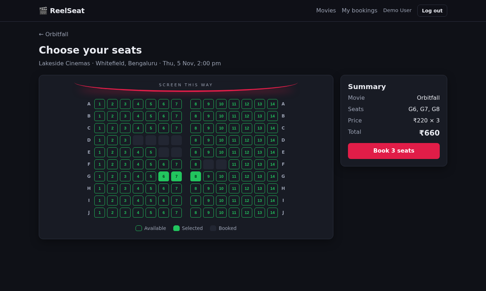

## Tech stack

| Layer    | Choice |
|----------|--------|
| Backend  | Node.js 22.13+, Express 5, `node:sqlite` (built in, no native build), jsonwebtoken, bcryptjs |
| Database | SQLite in WAL mode. Foreign keys cascade, and a `UNIQUE(show_id, seat)` constraint blocks double booking |
| Frontend | React 19, Vite, React Router 7, plain CSS (responsive, dark theme) |
| Testing  | node:test + Supertest (25 API tests) · Vitest + Testing Library (12 UI tests) |

## Features by role

| Role | Can do |
|------|--------|
| **User** | Browse movies with search and genre filter · view movie details and showtimes by day and theatre · pick seats on an interactive map with a live total (up to 10 seats) · view booking history (upcoming and past) · **edit** seats on a booking · **cancel** a booking |
| **Admin** | View stats (movies, theatres, shows, bookings) · **add and delete movies** · **add and delete theatres** with a seat layout (rows × seats per row) · schedule and delete shows · view every booking with customer details and revenue, and cancel any booking |

After logging in, users land on `/movies` and admins on `/admin`. Pages for the other role redirect away, and the API returns `403` for them as well.

## Getting started

You need **Node.js 22.13 or newer**.

```bash
# 1. API (http://localhost:4000/api)
cd server
npm install
cp .env.example .env        # optional: set JWT_SECRET etc.
npm run dev

# 2. Web app (http://localhost:5173), in a second terminal
cd client
npm install
npm run dev
```

Open http://localhost:5173. The Vite dev server forwards `/api` to the backend on port 4000.

On first start, the server creates `server/reelseat.db` and fills it with demo data: 6 movies, 3 theatres, and 36 shows spread over the next 3 days. To reset it, stop the server, delete `server/reelseat.db*`, and start it again.

### Tests and build
```bash
cd server && npm test                     # 25 API integration tests on an in-memory database
cd client && npm test                     # 12 component and routing tests
cd client && npm run lint && npm run build
```

## Demo credentials

These are also listed under "Demo credentials" on the login page.

| Role  | Email                | Password    |
|-------|----------------------|-------------|
| Admin | `admin@reelseat.com` | `Admin@123` |
| User  | `user@reelseat.com`  | `User@1234` |

New accounts created from the **Sign up** page are always regular users.

## Environment variables (`server/.env`)

| Variable | Default | Purpose |
|----------|---------|---------|
| `PORT` | `4000` | API port |
| `JWT_SECRET` | random each start (dev only) | Key used to sign tokens. **Required when `NODE_ENV=production`** |
| `JWT_EXPIRES_IN` | `2h` | How long a token stays valid |
| `DB_PATH` | `reelseat.db` | Location of the SQLite file |
| `CLIENT_ORIGIN` | `http://localhost:5173` | Origin allowed by CORS |
| `TRUST_PROXY` | `false` | Express `trust proxy` setting, for running behind a reverse proxy |
| `ADMIN_EMAIL` / `ADMIN_PASSWORD` | demo values | Initial admin account, created only when the database is empty |

## Authentication and access control

- `POST /api/auth/login` checks the password against a bcrypt hash and returns a JWT (HS256) containing `{ sub: userId, role }`.
- The frontend stores the token and sends it with every API call as `Authorization: Bearer <token>`.
- The `authenticate` middleware verifies the token, with the algorithm pinned to HS256. It then reloads the user from the database, so deleting a user or changing their role takes effect immediately. `requireRole('admin')` protects every catalogue write.
- Users can see and change only their own bookings. A request for someone else's booking returns `404`, so its existence isn't revealed. The seat map shows which seats are taken, never who took them.
- Failed logins are rate-limited. Logins for unknown emails still run a bcrypt comparison, so response times don't reveal which emails are registered.
- On the frontend, `ProtectedRoute` checks the session (restored with `GET /auth/me` on load) and the role. Any `401` logs the user out and sends them to `/login`. After logging in, the user returns to the page they originally asked for, if their role allows it.

## API documentation

The full reference, with request and response shapes, status codes, error format and booking rules, is in **[docs/API.md](docs/API.md)**. Quick map:

| Area | Endpoints | Access |
|------|-----------|--------|
| Auth | `POST /auth/register`, `POST /auth/login`, `GET /auth/me` | public / token |
| Movies | `GET /movies`, `GET /movies/:id` · `POST /movies`, `DELETE /movies/:id` | token · admin |
| Theatres | `GET /theatres` · `POST /theatres`, `DELETE /theatres/:id` | token · admin |
| Shows | `GET /shows`, `GET /shows/:id` · `POST /shows`, `DELETE /shows/:id` | token · admin |
| Bookings | `GET /bookings`, `POST /bookings` | token (admins see all) |
| Booking | `GET`, `PUT`, `DELETE /bookings/:id` | owner (admins can GET and DELETE) |

Requirements, data model and architecture are in [docs/DESIGN.md](docs/DESIGN.md).

## Project structure

```
server/
  src/
    app.js              Express app factory (security headers, routers, error handler)
    index.js            Entry point
    config.js           Environment configuration
    db.js               Schema and transaction helper
    middleware/         JWT authentication, role guard, rate limiter
    routes/             auth, movies, theatres, shows, bookings
    validation.js       Input and seat validation
    seed.js             Demo data
  test/                 API integration tests
client/
  src/
    api/client.js       Fetch wrapper that attaches the bearer token and handles 401
    context/            Auth provider and helpers
    components/         SeatMap, ProtectedRoute, Navbar, Poster, ConfirmButton, ...
    pages/              Login, Register, MovieList, MovieDetails, SeatSelection, Bookings
    pages/admin/        Admin dashboard and its Movies / Theatres / Shows / Bookings tabs
    test/               Vitest suites
docs/
  DESIGN.md             Requirements and design
  API.md                API reference
  screenshots/
```

## Screenshots

| | |
|---|---|
| **Login (role-based redirect)** 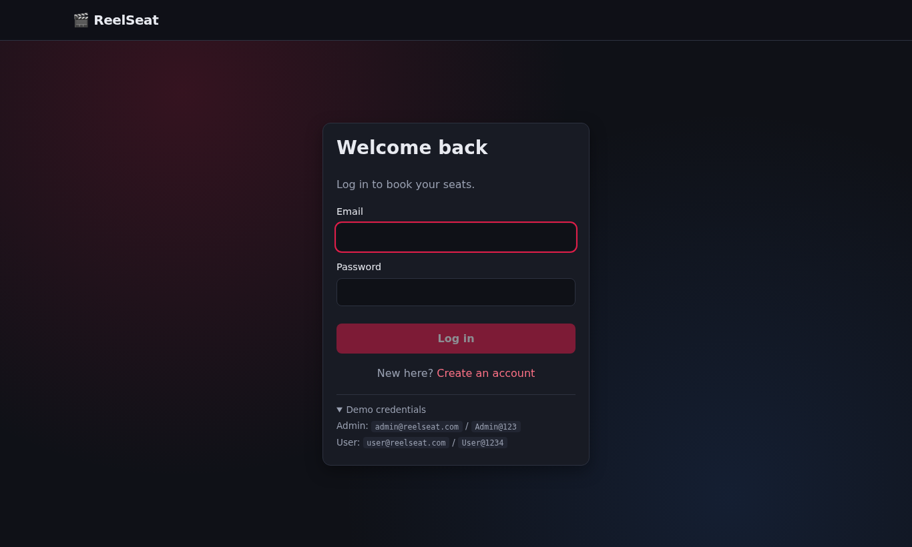 | **Movie listing** 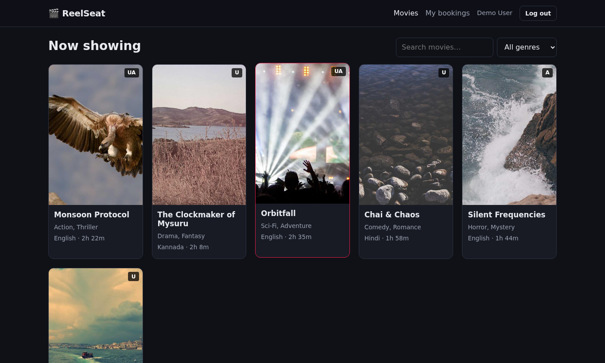 |
| **Movie details and showtimes** 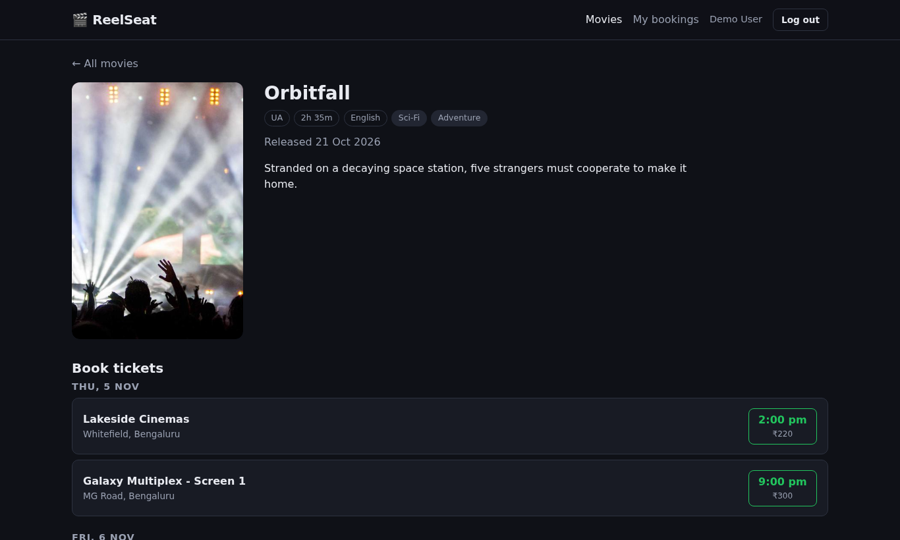 | **Seat selection**  |
| **Booking history** 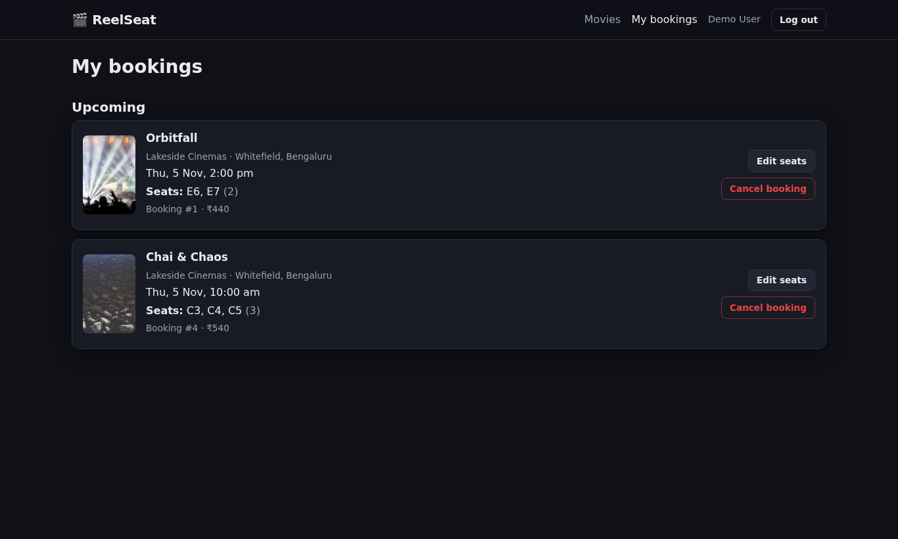 | **Edit booking** 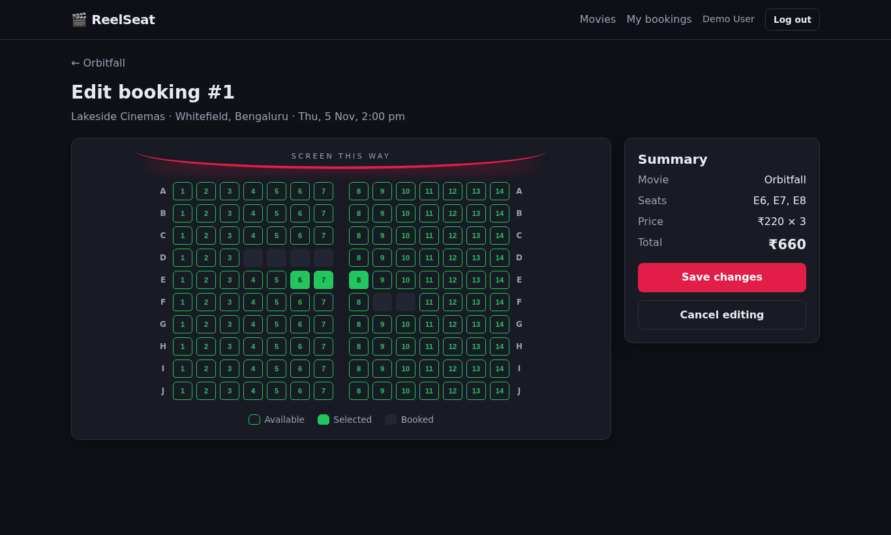 |
| **Admin: movies** 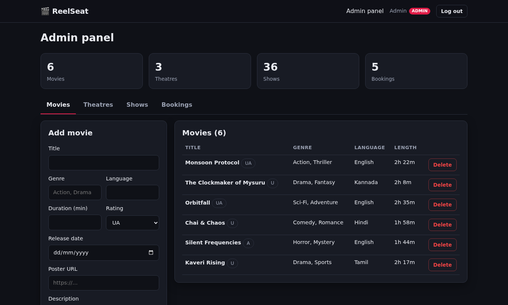 | **Admin: theatres** 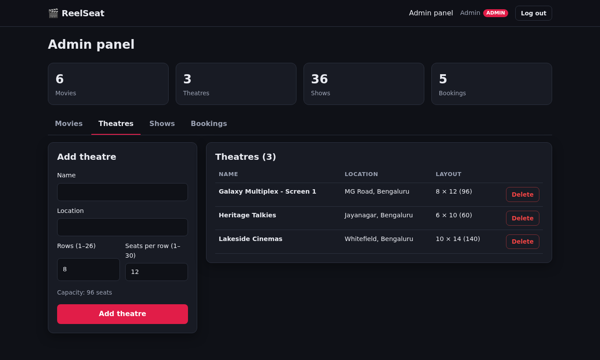 |
| **Admin: shows** 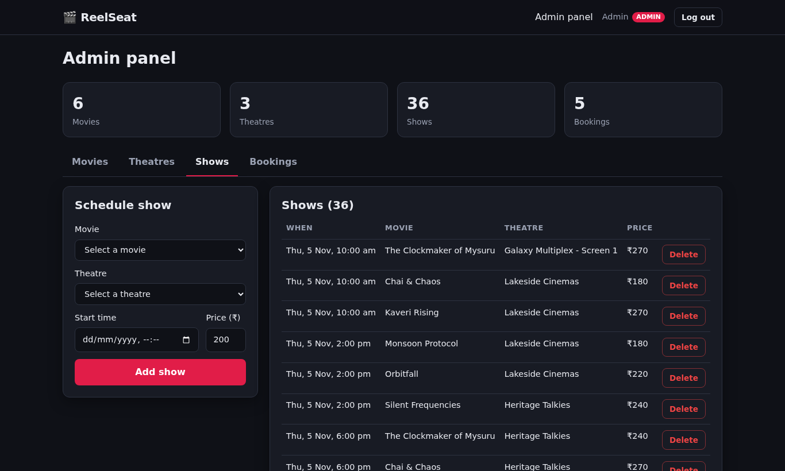 | **Admin: all bookings** 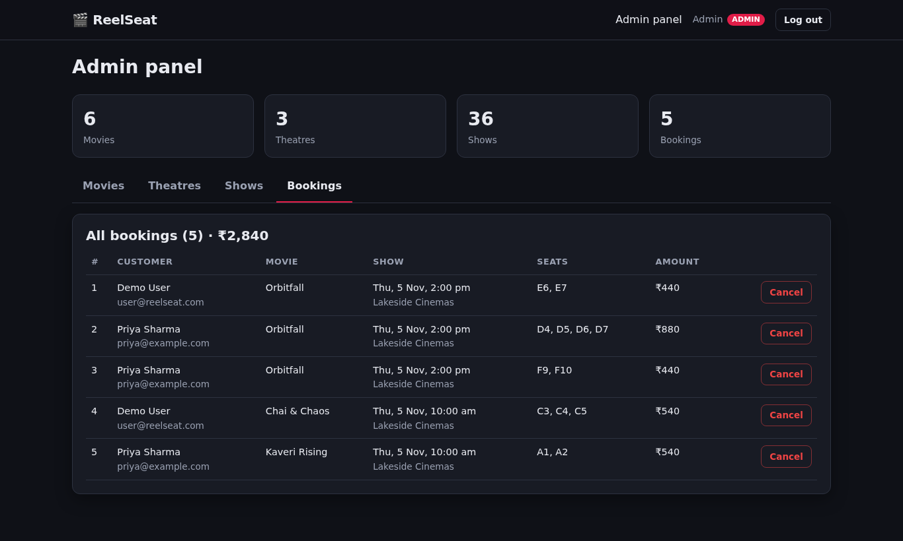 |

### Mobile

| Movies | Seat selection | Bookings | Admin |
|---|---|---|---|
| 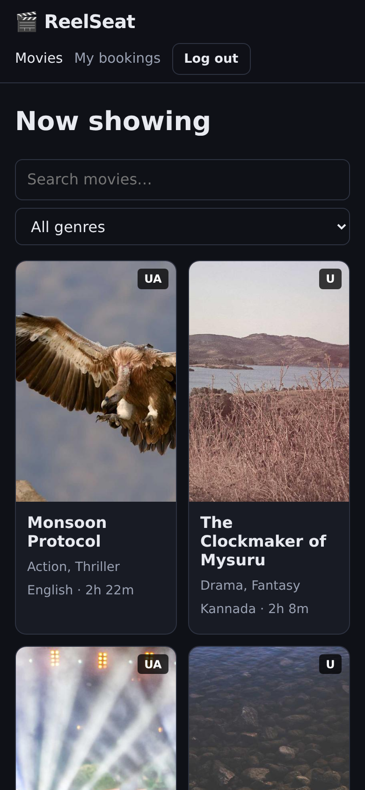 | 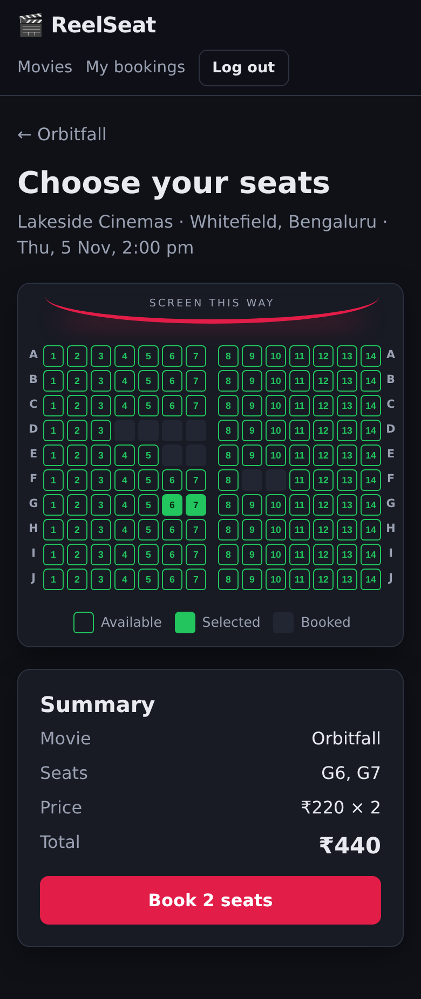 | 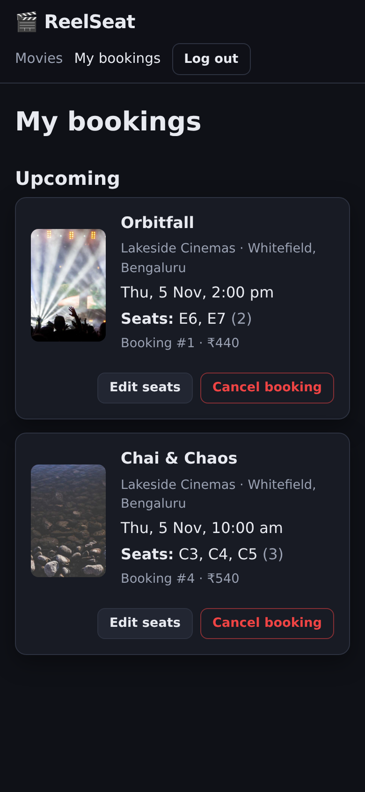 | 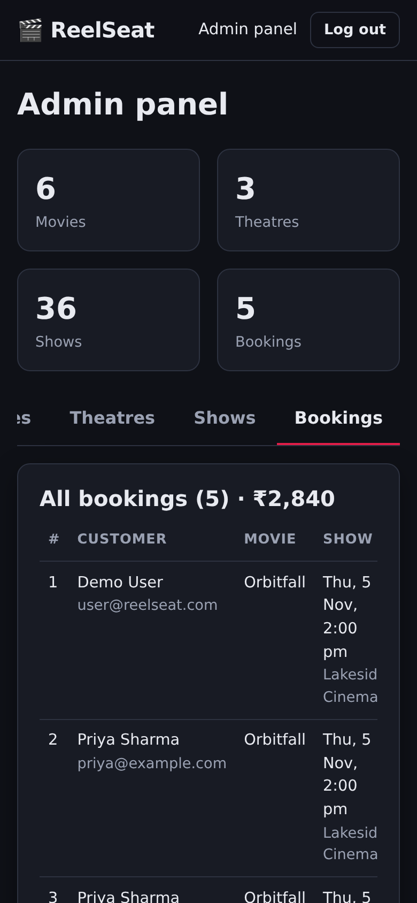 |
